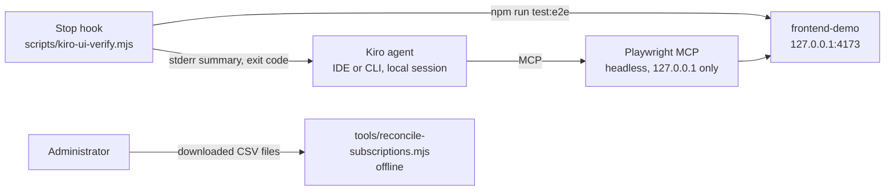

# Kiro enterprise adoption playbook (prototype)

> **Prototype — for demonstration and learning only, not for production use.**
>
> - You are responsible for how you deploy and use this code and for the results.
> - Before any use beyond a sandbox, evaluate it with your own security and legal teams, following the
>   [AWS shared responsibility model](https://aws.amazon.com/compliance/shared-responsibility-model/).
> - Hardening steps before production: [`SECURITY.md`](SECURITY.md#hardening-before-production-use) and
>   [`docs/handover.md`](docs/handover.md).
>
> Suggested repository name when published: `kiro-enterprise-adoption-playbook`. Version: see `VERSION`.

[中文说明](README.zh-CN.md)

A configuration and troubleshooting reference for engineering teams piloting Kiro, organised by the problems
teams report during a pilot rather than by product feature:

| Problem reported during a pilot | Where to look |
|---|---|
| Long-running work is hard to leave unattended; no browser-driven test loop | `docs/problem-action-matrix.md`, `docs/usage-modes.md`, `examples/` |
| Repetitive interaction while debugging; dragging files into chat | `docs/interaction-efficiency.md` |
| Sensitive to network conditions; dropped connections | `docs/network-checklist.md` |
| Credits consumed faster than expected | `docs/credit-governance.md` |
| Central account and subscription management; batch onboarding; migration | `docs/enterprise-admin.md` |
| Kick-off day, workshops, feedback loop, monthly reconciliation | `docs/runbook-activation-day.md` |

Every product statement is tied to an official page and a verification date in the fact table of
`docs/architecture.md`. Statements that could not be verified are listed in `docs/unverified-removed.md`. The main
documents are written in Chinese for the target audience.

## Architecture

Nothing runs in AWS. The pieces are documents, example Kiro configuration that you copy into a team repository,
a synthetic frontend served on `127.0.0.1`, and offline scripts. Components, trust boundaries, topology and
trade-offs: `docs/architecture.md` (the mermaid diagrams there are the source of truth).



## Prerequisites and cost

| Item | Requirement |
|---|---|
| Node.js | 20 or later (verified on Node 24), npm, git |
| Network | npm registry and the Playwright browser download on first setup |
| Kiro (only to use the examples inside Kiro) | Kiro IDE 1.0 or Kiro CLI V3 or later; MCP not disabled by the organisation |
| AWS account | Not needed |

Cost dimensions (no amounts are given here; check the official pages):

- **Kiro**: per-user subscription tier with a monthly credit allowance; credits are consumed per request, and
  optional overages are billed separately when an administrator enables them (`docs/credit-governance.md`).
  Each automatic retry of the example Stop hook starts another agent turn, which consumes credits; the hook's own
  command action does not. Pricing: https://kiro.dev/pricing/ and https://kiro.dev/docs/billing/ .
- **AWS**: this repository creates no AWS resources. If your administrator enables Kiro user activity reports,
  they are written to an S3 bucket in your account and billed as S3 storage and requests
  (https://aws.amazon.com/s3/pricing/). Do not assume a free tier. You can set a budget alert with
  AWS Budgets (https://docs.aws.amazon.com/cost-management/latest/userguide/budgets-create.html).

## Deploy

"Deploy" means installing the local test dependencies and copying `examples/` into a practice repository. This is
the only place in the repository where these commands are written; other documents refer here.

```bash
make preflight      # read-only tool chain check
make setup          # npm ci for examples/frontend-demo and Playwright Chromium (no global installs)
make test           # unit tests and browser tests
```

To use the examples inside Kiro, copy the contents of `examples/` to the root of a practice repository
(the layout is shown in `docs/deployment-guide.md`), then:

```bash
cd <PRACTICE_REPO>
npm install --prefix frontend-demo && npm --prefix frontend-demo run browsers:install
```

In Kiro, confirm that MCP support is enabled and the `playwright` server is connected (F-01). The Kiro-side steps
follow the official documentation and were **not run inside Kiro** by this project.

## Use and verify

| Command | What it shows |
|---|---|
| `make verify` | Lint, all tests, and reachability of the official links |
| `npm --prefix examples/frontend-demo start` | The demo page at `http://127.0.0.1:4173/` (add `?simulate-error=1` for a console error) |
| `npm run reconcile:sample` | Monthly reconciliation on synthetic data: match statistics and eight categories |
| `make scan` | gitleaks over the full history, plus a canary that must be detected |

A walkthrough for demos is in `docs/demo-script.md`; parameters are in `docs/deployment-guide.md`. Results of the
last verification, with the commit they apply to and what they do not prove: `VERIFICATION.md`.

## Troubleshooting

| Symptom | Cause and fix |
|---|---|
| Stop hook reports `passed=0 failed=0` and "reported no failed test" | Playwright stopped before running tests; the output tail in the message shows why (missing browser: `make setup`). If another program, not the demo, listens on the port, stop it or set `PORT` |
| Stop hook exits with code 3 | The automatic retry limit was reached (`KIRO_UI_VERIFY_MAX_ATTEMPTS`, default 2). Fix the cause; a passing run resets the counter |
| Reconciliation exits with code 2 | A column is missing or `--month` matched no rows; the message lists the columns and sample dates. Map columns with `--sub-key`, `--sub-status`, `--act-key` |
| Reconciliation exits with code 3 | The join key matched no or few users; check that both columns hold the same attribute before acting |
| `playwright` MCP server does not start in Kiro | MCP disabled or not in the organisation's MCP registry (F-36), or `npx` cannot reach the registry (`docs/network-checklist.md`) |
| Sign-in works for some users only | Often TLS inspection; follow `docs/network-checklist.md` |

## Security and limitations

- Page content and console messages read by the agent are untrusted input to the model; see `THREAT_MODEL.md`
  (Status: DRAFT) and `SECURITY-NOTES.md`.
- Kiro-side behaviour (MCP calls, steering loading, hook triggering) comes from the official documentation and was
  not run inside Kiro. Open technical questions: `OPEN-QUESTIONS.md`.
- The reconciliation join key and the export header spelling are assumptions (Q-04).

## Cleanup

```bash
make clean            # local: demo dependencies and test output, asks for confirmation
make verify-cleanup   # read-only AWS residue check by prefix proto-kiro- and project tag; non-zero exit on residue
```

Not removed automatically — remove them yourself if needed, and do not assume a finished command means everything
is gone:

- The Playwright browser cache (shared with other projects on the machine): `npx --prefix examples/frontend-demo playwright uninstall`.
- The npx cache entry of `@playwright/mcp` created when Kiro starts the MCP server.
- The Stop hook retry counters in the system temporary directory (`kiro-ui-verify/`), unless you confirm their
  removal in `make clean`.
- Anything copied into other repositories (`.kiro/` files, `scripts/kiro-ui-verify.mjs`, `frontend-demo/`).
- Kiro profiles, subscriptions, and the S3 bucket for user activity reports: created by your administrator, not by
  this repository.

## Repository layout

```text
docs/          problem-action matrix, topic guides, architecture and fact check, prior art, runbooks, standards review
examples/      .kiro/ configuration, hook script, synthetic frontend with Playwright tests
tools/         reconciliation, link check, lint, preflight, secret scan, cleanup and residue check
tests/         unit and integration tests (node:test)
sample-data/   synthetic CSV files
.github/       CI workflow, Dependabot, CODEOWNERS, issue and pull request templates
```

## Local tests

```bash
make lint        # syntax, JSON, text hygiene
make test-unit   # node:test, includes the Stop hook integration test when the demo dependencies are installed
make test-e2e    # Playwright browser tests
make links       # official links reachable (network)
```

## Contributing

See [CONTRIBUTING](CONTRIBUTING.md) for more information.

## Security

See [CONTRIBUTING](CONTRIBUTING.md#security-issue-notifications) for more information.

## License

This library is licensed under the MIT-0 License. See the [LICENSE](LICENSE) file.
