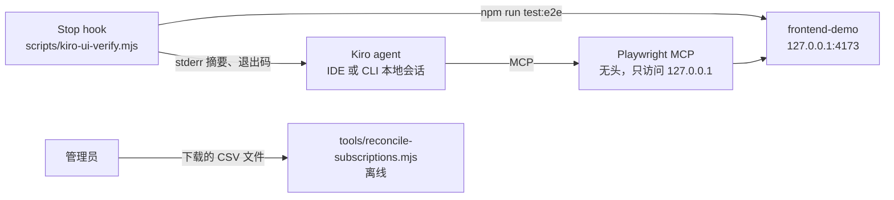

# 企业研发团队落地 Kiro 的配置与排障参考（原型）

> **Prototype：仅用于演示和学习，不用于生产。**
>
> - 使用方对如何部署、使用本代码以及由此产生的后果负责。
> - 在沙箱之外使用前，请与自己的安全和法务团队评估，遵循
>   [AWS 责任共担模型](https://aws.amazon.com/compliance/shared-responsibility-model/)。
> - 上生产前的加固步骤：[`SECURITY.md`](SECURITY.md#hardening-before-production-use) 与
>   [`docs/handover.md`](docs/handover.md)。
>
> 建议发布时的仓库名：`kiro-enterprise-adoption-playbook`。版本见 `VERSION`。

[English](README.md)

把企业研发团队试用 Kiro 时反馈的问题，整理成「问题 → 官方可核实的处置方式 → 配置示例 → 不能解决时怎么办」：

| 试用中反馈的问题 | 对应文档 |
|---|---|
| 长周期任务难以无人值守；缺少浏览器联动的自动化测试 | `docs/problem-action-matrix.md`、`docs/usage-modes.md`、`examples/` |
| 调试时交互重复；拖拽文件进对话框 | `docs/interaction-efficiency.md` |
| 对网络环境要求高、易断线 | `docs/network-checklist.md` |
| Credit 消耗过快 | `docs/credit-governance.md` |
| 账号与订阅统一管理、分批导入、旧账号迁移 | `docs/enterprise-admin.md` |
| 启动日与 workshop、试用期反馈、月度核对 | `docs/runbook-activation-day.md` |

所有产品说法都在 `docs/architecture.md` 的「事实核对」中有编号、官方链接和核实日期。核实不了的内容列在 `docs/unverified-removed.md`。

## 架构

不在 AWS 中运行任何东西。组成部分是文档、复制到团队仓库使用的 Kiro 示例配置、只监听 `127.0.0.1` 的合成前端、离线脚本。组件、信任边界、拓扑与取舍见 `docs/architecture.md`（其中的 mermaid 图是事实来源）。



## 前置条件和成本

| 项目 | 要求 |
|---|---|
| Node.js | 20 及以上（在 Node 24 上验证），以及 npm、git |
| 网络 | 首次安装需访问 npm 源与 Playwright 浏览器下载地址 |
| Kiro（仅在 Kiro 内使用示例时） | Kiro IDE 1.0 或 Kiro CLI V3 及以上；组织未关闭 MCP |
| AWS 账号 | 不需要 |

计费维度（这里不写金额，以官方页面为准）：

- **Kiro**：按用户订阅套餐，每月有 credit 额度；credit 按请求计量；管理员开启超额后，超额部分另行计费（`docs/credit-governance.md`）。示例 Stop hook 每次自动回传都会让 agent 多一个回合，这个回合消耗 credit；hook 自身的 command 动作不消耗。定价见 https://kiro.dev/pricing/ 与 https://kiro.dev/docs/billing/ 。
- **AWS**：本仓库不创建任何 AWS 资源。如果管理员开启 Kiro 用户活动报告，报告写入你账号中的 S3 桶，按 S3 存储与请求计费（https://aws.amazon.com/s3/pricing/ ）。不要假定有免费额度。可以用 AWS Budgets 设置预算告警（https://docs.aws.amazon.com/cost-management/latest/userguide/budgets-create.html ）。

## 部署

「部署」指安装本地测试依赖，并把 `examples/` 复制到练习仓库。这些命令只写在这里，其他文档引用本节。

```bash
make preflight      # 只读检查工具链
make setup          # 为 examples/frontend-demo 执行 npm ci 并下载 Playwright Chromium（不做全局安装）
make test           # 单元测试与浏览器测试
```

要在 Kiro 中使用示例：把 `examples/` 的内容复制到练习仓库根目录（目录结构见 `docs/deployment-guide.md`），然后：

```bash
cd <PRACTICE_REPO>
npm install --prefix frontend-demo && npm --prefix frontend-demo run browsers:install
```

在 Kiro 中确认 MCP 支持已启用、`playwright` 服务器已连接（F-01）。Kiro 侧步骤依据官方文档编写，本项目**未在 Kiro 内运行**。

## 使用和验证

| 命令 | 内容 |
|---|---|
| `make verify` | lint、全部测试、官方链接可达性 |
| `npm --prefix examples/frontend-demo start` | 打开 `http://127.0.0.1:4173/` 查看示例页面（加 `?simulate-error=1` 产生控制台错误） |
| `npm run reconcile:sample` | 用合成数据做月度核对：匹配统计与八类结果 |
| `make scan` | gitleaks 扫描全部历史，并确认能检出植入的假凭证 |

演示步骤见 `docs/demo-script.md`，参数见 `docs/deployment-guide.md`。最近一次验证结果（含对应提交、局限与「不能证明什么」）见 `VERIFICATION.md`。

## 故障排查

| 现象 | 原因与处理 |
|---|---|
| Stop hook 报 `passed=0 failed=0` 且提示「reported no failed test」 | Playwright 在运行测试前就失败了，提示中的输出尾部会给出原因（缺浏览器：`make setup`）。端口上如果是别的程序而不是示例前端，停掉它或改 `PORT` |
| Stop hook 以退出码 3 结束 | 达到自动重试上限（`KIRO_UI_VERIFY_MAX_ATTEMPTS`，默认 2）。修好原因后，测试通过会清零计数 |
| 核对工具退出码 2 | 缺列或 `--month` 没有匹配行；提示中列出实际列名与日期样例。用 `--sub-key`、`--sub-status`、`--act-key` 映射列名 |
| 核对工具退出码 3 | 关联键对不上或匹配率低；先确认两边的列是同一属性，再据此操作 |
| Kiro 中 `playwright` MCP 服务器启动不了 | MCP 被关闭或不在组织的 MCP registry 中（F-36），或 `npx` 访问不到 npm 源（`docs/network-checklist.md`） |
| 部分用户能登录、部分不能 | 常见原因是 TLS 检查，按 `docs/network-checklist.md` 排查 |

## 安全与局限

- agent 读取的页面内容和控制台消息是交给模型的不可信输入，见 `THREAT_MODEL.md`（Status: DRAFT）与 `SECURITY-NOTES.md`。
- Kiro 侧行为（MCP 调用、steering 载入、hook 触发）来自官方文档，未在 Kiro 内运行。待确认的技术问题见 `OPEN-QUESTIONS.md`。
- 核对工具的关联键与导出表头拼写是假设（Q-04）。

## 清理

```bash
make clean            # 本机：示例依赖与测试产物，执行前要求确认
make verify-cleanup   # 只读：按前缀 proto-kiro- 与项目标签核对 AWS 残留，有残留时非零退出
```

不会被自动删除的内容（需要时自行删除；不要以为命令跑完就删干净了）：

- Playwright 浏览器缓存（本机其他项目共用）：`npx --prefix examples/frontend-demo playwright uninstall`。
- Kiro 启动 MCP 服务器时 `npx` 缓存的 `@playwright/mcp`。
- 系统临时目录中 Stop hook 的重试计数文件（`kiro-ui-verify/`），除非在 `make clean` 中确认删除。
- 复制到其他仓库的内容（`.kiro/` 文件、`scripts/kiro-ui-verify.mjs`、`frontend-demo/`）。
- Kiro profile、订阅、存放用户活动报告的 S3 桶：由管理员创建，不是本仓库创建的。

## 目录结构

```text
docs/          问题—处置矩阵、专题文档、架构与事实核对、prior-art、手册、规范对齐 review
examples/      .kiro/ 配置、hook 脚本、合成前端与 Playwright 测试
tools/         订阅核对、链接检查、lint、预检、secret 扫描、清理与残留核对
tests/         单元测试与集成测试（node:test）
sample-data/   合成 CSV
.github/       CI workflow、Dependabot、CODEOWNERS、issue 与 PR 模板
```

## 本地测试

```bash
make lint        # 语法、JSON、文本规范
make test-unit   # node:test；已安装示例依赖时包含 Stop hook 集成测试
make test-e2e    # Playwright 浏览器测试
make links       # 官方链接可达性（需联网）
```

## Contributing

See [CONTRIBUTING](CONTRIBUTING.md) for more information.

## Security

See [CONTRIBUTING](CONTRIBUTING.md#security-issue-notifications) for more information.

## License

This library is licensed under the MIT-0 License. See the [LICENSE](LICENSE) file.
