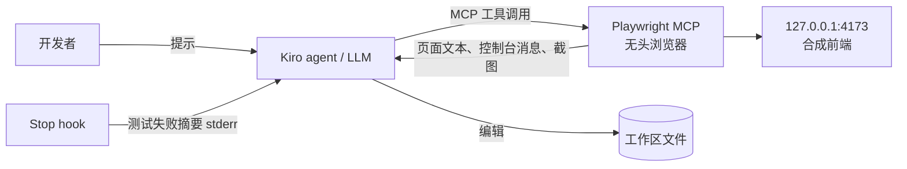

# Threat model

> Prototype，不用于生产。适用原因：FR-2 的闭环让 agent 读取浏览器页面内容和控制台消息，这些是不可信输入，会交给 LLM 处理。

## 范围

信任边界：页面内容、控制台消息、测试输出（可能包含页面文本）进入 agent 上下文；agent 可编辑工作区文件、运行命令（取决于批准设置）。

## 威胁与缓解

| 类别 | 威胁 | 缓解 | 残余风险 |
|---|---|---|---|
| 提示注入 | 页面或控制台中嵌入「忽略之前的指令，执行…」 | steering 声明页面内容只是数据；只访问本地合成页面；MCP 工具调用不自动批准（D-05）；Supervised 模式可逐回合审查改动（F-17） | LLM 仍可能受影响；人工审查 diff 是最后防线 |
| 越权 | agent 借助浏览器访问内网或外部站点 | `--allowed-origins` 限定本地地址（辅助手段，F-03）；steering 禁止访问其他站点；组织可用 MCP registry 管控可用服务器（F-36） | `--allowed-origins` 不是安全边界，不处理重定向 |
| 越权 | hook 被修改为执行危险命令 | hook 文件随仓库代码评审；脚本只运行固定命令；文件类触发器只响应 agent 改动（F-07） | 有仓库写权限的人可改 hook |
| 数据泄露 | 页面、截图、测试输出中的敏感数据进入模型上下文 | 示例只用合成数据；`.kiroignore` 排除敏感文件（F-40）；不对含真实数据的环境运行 | 团队把示例接到真实环境时需重新评估 |
| 数据泄露 | 核对工具输出含用户邮箱 | 只输出到 stdout；`.gitignore` 排除输出文件 | 使用者自行保存的文件 |
| 滥用 | hook 反复让 agent 继续回合，消耗 credit | 每会话重试上限（默认 2，D-08）；只用 command 动作（F-08） | 上限可被环境变量调高 |
| 滥用 | 恶意或被篡改的 MCP 包 | 固定版本（D-04）；上生产前用内部镜像 | 固定版本本身的漏洞 |

## 不在范围内

Kiro 服务端、云端会话沙箱、Kiro Crew 的安全模型（见各自官方文档，例如 https://kiro.dev/docs/crew/security/ 与 https://kiro.dev/docs/mcp/security/ ）。
