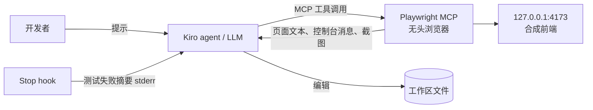

# Threat model

> Prototype，不用于生产。适用原因：FR-2 的闭环让 agent 读取浏览器页面内容和控制台消息，这些是不可信输入，会交给 LLM 处理。

## 范围

信任边界：页面内容、控制台消息、测试输出（可能包含页面文本）进入 agent 上下文；agent 可编辑工作区文件、运行命令（取决于批准设置）。

## 威胁与缓解

| 类别 | 威胁 | 缓解 | 残余风险 |
|---|---|---|---|
| 提示注入 | 页面或控制台中嵌入「忽略之前的指令，执行…」 | steering 声明页面内容只是数据；只访问本地合成页面；MCP 工具调用不自动批准（D-05）；Supervised 模式可逐回合审查改动（F-17） | LLM 仍可能受影响；人工审查 diff 是最后防线 |
| 越权 | agent 借助浏览器访问内网或外部站点 | `--allowed-origins` 限定本地地址（辅助手段，F-03）；steering 禁止访问其他站点；组织可用 MCP registry 管控可用服务器（F-36） | `--allowed-origins` 不是安全边界，不处理重定向 |
| 越权 | 有仓库写权限的人把 hook 改为执行危险命令 | hook 文件与脚本随仓库代码评审；脚本只运行固定命令，参数不来自事件内容 | 评审遗漏；hook 的 command 动作以开发者权限运行 |
| 篡改 / 绕过验证 | agent 在会话中（例如被页面内容注入后）改写 `.kiro/hooks/*.json`、`scripts/kiro-ui-verify.mjs`、`frontend-demo/tests/**` 或 `playwright.config.mjs`：把恶意命令持久化到下一次 hook 运行，或删改测试、关闭 hook，让验证「通过」 | steering 要求不为了通过而改测试，改了必须明说；Supervised 模式下每个含文件改动的回合需批准（F-17）；回合结束后用 `git diff -- .kiro scripts frontend-demo/tests frontend-demo/playwright.config.mjs` 检查这些路径，有改动时按代码评审处理；可在 CI 或 pre-commit 中对这些路径要求代码所有者评审 | 官方「文件类触发器只响应 agent 改动」（F-07）只说明哪些改动会**触发** hook，并不阻止 agent 改写 hook 或测试，不是对此威胁的缓解。Autopilot 模式下改动不逐回合批准；脚本与测试每次运行时重新读取，篡改立即生效；hook 配置官方写明在会话开始时自动激活（F-07），会话中改写是否立即生效官方未写明 |
| 数据泄露 | 页面、截图、测试输出中的敏感数据进入模型上下文 | 示例只用合成数据；`.kiroignore` 排除敏感文件（F-40）；不对含真实数据的环境运行 | 团队把示例接到真实环境时需重新评估 |
| 数据泄露 | 核对工具输出含用户邮箱 | 只输出到 stdout；`.gitignore` 排除输出文件 | 使用者自行保存的文件 |
| 滥用 | hook 反复让 agent 继续回合，消耗 credit | 每会话（无会话 ID 时按工作区）最多自动回传 2 次，超过后以退出码 3 结束、不请求新回合；计数只在测试通过后清零；文件未变化时不重跑（D-08）；只用 command 动作（F-08） | 上限可被环境变量调高；删除系统临时目录中的计数文件会重置计数；agent 也可能改写脚本（见上面「篡改」一行） |
| 滥用 | 恶意或被篡改的 MCP 包 | 固定版本（D-04）；上生产前用内部镜像 | 固定版本本身的漏洞 |

## 不在范围内

Kiro 服务端、云端会话沙箱、Kiro Crew 的安全模型（见各自官方文档，例如 https://kiro.dev/docs/crew/security/ 与 https://kiro.dev/docs/mcp/security/ ）。
