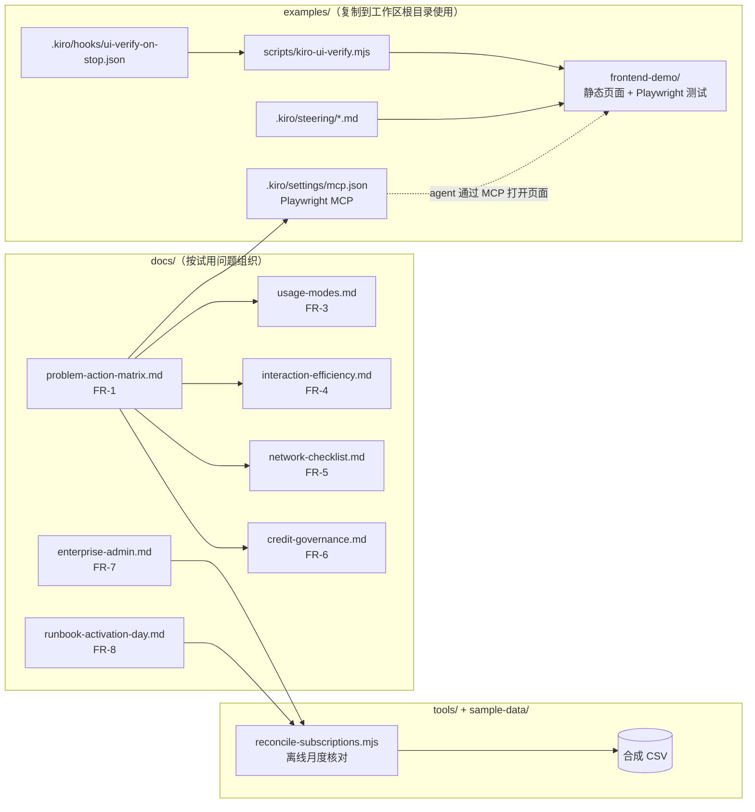
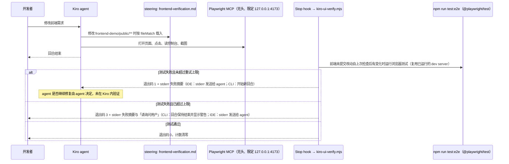

# 架构、设计取舍与事实核对

> Prototype，不用于生产。本文是仓库内所有产品事实的唯一来源；其他文档引用这里的编号（F-xx）。

## 1. 仓库组成

本项目以文档和示例配置为主，没有部署到 AWS 的组件（原因见 `DEPLOYMENT-LOG.md` 与 `DECISIONS.md`）。

FR-2 的自动化测试闭环（在 Kiro IDE 或 CLI 本地会话中）：

说明：上图中 Kiro 侧（steering 载入、MCP 调用、hook 触发）**未在 Kiro 内运行**，本机没有 Kiro IDE。仓库只在本机实际运行了 `frontend-demo` 的 Playwright 测试、hook 脚本的单元测试（用假 runner）和配置格式校验，见 `VERIFICATION.md`。

## 2. 设计取舍

| 取舍 | 选择 | 理由 |
|---|---|---|
| 组织方式 | 按「试用中遇到的问题」组织，官方已有的内容只链接 | 需求输入的差异化方向；避免重写官方文档 |
| 端点清单 | 只列类别和两个官方排障命令里出现的端点，完整清单链接官方页面 | 端点会变；复制整表容易过期（D-10） |
| Playwright MCP 版本 | 固定版本号，不用 `@latest` | 官方一键安装配置用 `@latest`；固定版本便于复现和审查（D-04） |
| hook 动作类型 | 只用 command 动作 | 官方说明 Agent Prompt 动作会消耗 credit，Shell Command 不会（F-08，D-07） |
| 失败回传方式 | stderr + 退出码 1，带每会话重试上限；超过上限用退出码 3 | 同时符合 IDE 与 CLI 文档描述的语义；上限防止无限追加回合；上限提示不放在会被忽略的退出码 0 stdout 中（D-08） |
| AWS 部署 | 不适用 | 无可在沙箱端到端验证的组件（D-02） |
| 工具链 | 只用 Node（Playwright 需要 Node） | 没有 IaC，不引入第二种语言（D-03） |
| 数字 | 不写价格、额度、倍率、并发上限等数字 | 项目约定；一律指向官方页面（D-14） |

## 3. 局限

- Kiro IDE / CLI / Web / Crew 本身不在本机，所有 Kiro 行为来自官方文档，未实测。
- 官方文档持续更新（本次核对日期 2026-10-20）。发布前应重新核对 F-xx 链接，可运行 `npm run check:links` 检查链接是否可访问（只检查可达性，不检查内容）。
- 订阅导出 CSV 的列名拼写、订阅导出与活动报告之间的关联键，官方未写明，工具用可配置列名处理（见 `OPEN-QUESTIONS.md`）。
- 试用反馈原文与场景细节未提供，矩阵背景列用通用描述。

## 4. 事实核对

核对日期：**2026-10-20**。核对方式：用 curl 下载 kiro.dev 文档页面的 Markdown 版本（文档页提供 `.md` 视图）、changelog 与博客页面全文检索，AWS 文档页面直接读取。本次修订新增或改动的条目（F-06、F-07、F-08、F-09、F-31、F-41、F-44、F-45、F-46）另用网页读取工具逐页打开官方页面核对原文。凡是下表没有的产品说法，仓库内都不应出现。核对不了的内容见 `docs/unverified-removed.md`。

| 编号 | 说法（仓库内使用的版本） | 官方链接 | 核实日期 |
|---|---|---|---|
| F-01 | MCP 配置为 JSON，顶层 `mcpServers`；本地服务器字段 `command`（必填）、`args`、`env`、`disabled`、`autoApprove`、`disabledTools`。工作区级 `.kiro/settings/mcp.json`，用户级 `~/.kiro/settings/mcp.json`，两者合并且工作区优先；保存文件后自动生效。IDE 需要在设置中启用 MCP 支持。 | https://kiro.dev/docs/mcp/configuration/ | 2026-10-20 |
| F-02 | Kiro 官方 MCP 服务器列表收录 Playwright：「Browser automation with Playwright for web scraping, screenshots, and test code generation」，需要 Node；一键安装配置为 `npx @playwright/mcp@latest`。 | https://kiro.dev/docs/mcp/servers/ | 2026-10-20 |
| F-03 | Playwright MCP 提供 `browser_navigate`、`browser_click`、`browser_take_screenshot`、`browser_console_messages`（读控制台消息）等工具；参数 `--headless`、`--isolated`、`--allowed-origins`（上游说明：不构成安全边界）。来源为该 MCP 服务器的上游官方仓库，不是 Kiro 文档。 | https://github.com/microsoft/playwright-mcp | 2026-10-20 |
| F-04 | Kiro 官方博客（云端执行）写明：在 Kiro Web 的云沙箱中运行应用，Kiro 用 Playwright 复现问题、修改后再次在真实浏览器中走一遍流程验证。该示例是 Kiro Web / 云沙箱场景。 | https://kiro.dev/blog/agentic-engineering-in-the-cloud/ | 2026-10-20 |
| F-05 | Kiro Web 每个沙箱内置无头 Chrome，并预装 Playwright MCP 服务器、agent-browser CLI、Chrome DevTools MCP 服务器，无需配置。 | https://kiro.dev/docs/web/sandbox/ ；https://kiro.dev/changelog/web/playwright-and-agent-browser-support/ | 2026-10-20 |
| F-06 | Steering：工作区 `.kiro/steering/`，全局 `~/.kiro/steering/`，冲突时工作区优先；全局目录可由 MDM / 组策略分发作为团队 steering。front matter 必须是文件第一段内容；`inclusion` 取值 `always`（默认）、`fileMatch`（配 `fileMatchPattern`，可为数组）、`manual`（用 `#文件名` 引用，也会出现在 `/` 斜杠命令中）、`auto`（需 `name`、`description`）。支持 `#[[file:路径]]` 引用。自定义 agent 不自动包含 steering。支持 AGENTS.md。Kiro CLI V3 支持全部四种 inclusion；V1/V2 只自动载入 `always`，`fileMatch` 与 `manual` 不自动载入。 | https://kiro.dev/docs/steering/ | 2026-10-20 |
| F-07 | Hooks：`.kiro/hooks/*.json`，`version: "v1"`，字段 `name`、`trigger`（PascalCase）、`matcher`、`action.type`（`command`/`agent`）、`action.command`/`action.prompt`、`timeout`（秒）、`enabled`。触发器包括 `SessionStart`、`Stop`、`UserPromptSubmit`、`PreToolUse`、`PostToolUse`、`PostFileCreate`、`PostFileSave`、`PostFileDelete`、`PreTaskExec`、`PostTaskExec`。command 动作在项目根目录运行，事件 JSON 从 STDIN 传入。`Stop` hook 不使用 matcher。文件类触发器只响应 agent 的改动（手动编辑不触发）。hooks 在会话开始时自动激活。hooks 页写明：Kiro Web 会话不运行这些触发器与 command / agent 动作（与 F-41 云端会话页的说法不一致，见 Q-11）。 | https://kiro.dev/docs/hooks/ ；https://kiro.dev/docs/hooks/types/ ；https://kiro.dev/docs/ide/whats-new-v1/hooks/ | 2026-10-20 |
| F-08 | Hook 动作：Agent Prompt 动作会触发新的 agent 循环并消耗 credit；Shell Command 动作不消耗 credit。IDE 中命令退出码 0 时 stdout 加入 agent 上下文，非零退出时 stderr 发送给 agent 并告知 hook 返回错误；CLI 的 `Stop` hook 退出码 1 会开始新的 agent 回合，退出码 0 且无继续决定时回合结束，其他退出码让回合保持结束且 hook 输出不转给 agent；CLI 中退出码 0 的 stdout 只对 SessionStart、UserPromptSubmit 加入上下文，其他触发器忽略，其他退出码显示警告后继续。 | https://kiro.dev/docs/hooks/actions/ ；https://kiro.dev/docs/hooks/types/ | 2026-10-20 |
| F-09 | Dev servers：agent 可在专用终端后台运行长时间进程（如开发服务器）并读取其输出；后台进程会一直运行，直到手动停止或关闭 Kiro；再次要求启动同一目录下的同一命令时复用已有进程而不重复启动；可用 steering 规定改动后检查输出；可配合 `#Problems`（该页写法为首字母大写）。 | https://kiro.dev/docs/ide/chat/dev-servers/ | 2026-10-20 |
| F-10 | IDE 聊天输入框用 `#` 调用上下文提供者：`#codebase`、`#file`、`#folder`、`#git diff`、`#terminal`、`#problems`、`#url`、`#code`、`#repository`、`#current`、`#steering`、`#docs`、`#spec`、`#mcp`，可组合使用。 | https://kiro.dev/docs/ide/chat/ | 2026-10-20 |
| F-11 | IDE 0.11 起可通过粘贴或拖拽把文档附加到聊天输入框，格式包括 PDF、CSV、DOC、DOCX、XLS、XLSX、HTML、TXT、Markdown；每条消息有附件数量上限（以官方页面为准）；可与文字、图片混合在同一条提示中。 | https://kiro.dev/changelog/ide/0-11/ | 2026-10-20 |
| F-12 | Kiro CLI：可把图片拖进终端窗口（插入路径），`/paste` 粘贴剪贴板图片；用 `@路径` 引用文件或目录，内容在发送前内联展开、避免工具调用。 | https://kiro.dev/docs/cli/chat/images/ ；https://kiro.dev/docs/cli/chat/file-references/ | 2026-10-20 |
| F-13 | 云端会话（cloud sessions）：在托管云沙箱运行 Kiro agent；会话属于账号，客户端断开不停止 agent，进行中的任务继续；对话历史、仓库、沙箱文件状态保存在云端，从任一客户端重新连接后回放记录；无人连接时的权限请求会等待下一个连接的客户端。IDE 在 Agent Focus 中创建，CLI 用 `--cloud`，Web 会话都是云端会话。前提：付费订阅；IAM Identity Center 组织需管理员启用 Cloud Sessions；仅 `us-east-1`。限制：无 Supervised 模式；IDE 中 `#File`/`#Folder`/`#Terminal`/`#Problems` 选择器不可用，图片和文档附件可用；有并发会话上限（以官方页面为准）。 | https://kiro.dev/docs/cloud-sessions/ | 2026-10-20 |
| F-14 | Kiro Web：浏览器中的开发 agent（app.kiro.dev），有默认、Spec、自主（autonomous）三种方式；不会自动合并；IAM Identity Center 组织需管理员启用 Cloud Sessions；仅 `us-east-1`。 | https://kiro.dev/docs/web/ | 2026-10-20 |
| F-15 | 自主模式：agent 规划、由子 agent 执行并验证、完成后开 PR/MR；模型由 agent 自动选择；需要澄清时任务进入 Needs attention 状态等待输入。云端会话中 IDE/CLI 也可选 Autonomous。 | https://kiro.dev/docs/web/autonomous-mode/ ；https://kiro.dev/docs/cloud-sessions/ | 2026-10-20 |
| F-16 | Kiro Web 标签页在后台后返回时会重新连接，并回放离开期间的会话活动，在睡眠或网络变化后恢复最新状态。 | https://kiro.dev/changelog/web/reasoning-effort-and-a-grouped-timeline/ | 2026-10-20 |
| F-17 | IDE 有 Autopilot（默认，自主完成）和 Supervised（每个含文件改动的回合等待批准）两种模式，可随时切换。 | https://kiro.dev/docs/ide/chat/autopilot/ | 2026-10-20 |
| F-18 | Kiro Crew：开源的个人 AI agent，运行在你自己的硬件上（本地或远程）；可从桌面应用、Web 仪表盘、CLI 以及 Slack、Teams 等聊天渠道使用；Task Runner 按 spec 拆解任务、执行、测试、失败重试并保存检查点，面向长时间无人值守运行；Browser 功能可操作真实浏览器并截图；可作为系统服务、Docker 或远程主机常驻；首次使用需安装 `kiro-cli` 并登录。 | https://kiro.dev/docs/crew/ ；https://kiro.dev/docs/crew/features/task-runner/ ；https://kiro.dev/docs/crew/features/browser/ ；https://kiro.dev/docs/crew/running-24-7/ ；https://kiro.dev/changelog/crew/0-1/ | 2026-10-20 |
| F-19 | Kiro 订阅可用于 Kiro IDE、Kiro CLI、Kiro Web、Kiro Crew、兼容 ACP 的 IDE 和软件开发自动化；不同界面都按同一 credit 模型计量，云端计算无单独收费。 | https://kiro.dev/faq/ | 2026-10-20 |
| F-20 | Kiro Mobile（iOS）通过 TestFlight 抢先体验，用于启动和指导云端会话，文档标注为 Preview。 | https://kiro.dev/docs/mobile/ | 2026-10-20 |
| F-21 | Kiro CLI 无头模式：`kiro-cli chat --no-interactive`，需要 API key（`KIRO_API_KEY`）；组织管理员需先允许生成 API key；管理员的治理规则同样适用。 | https://kiro.dev/docs/cli/headless/ | 2026-10-20 |
| F-22 | 防火墙/代理：官方页面按功能列出全部需放行的 URL（核心、IDE、CLI、Web、社交登录、IAM Identity Center、外部 IdP、GovCloud、订阅管理、可选）；`q.<region>.amazonaws.com` 为遗留端点但目前仍需放行；部分防火墙通配符只匹配一级子域；IDE/CLI 遵循 `HTTP_PROXY`、`HTTPS_PROXY`、`NO_PROXY`，IDE 也可在 Settings > Proxy 配置；浏览器登录走操作系统网络栈，绕过 IDE/CLI 代理设置。 | https://kiro.dev/docs/privacy-and-security/firewalls/ | 2026-10-20 |
| F-23 | 部分用户能连、部分不能时，常见原因是 TLS inspection；症状包括登录后显示 "No profiles available"、日志 `Failed to retrieve profiles`（空错误串表示网络层失败）；用 `curl -v https://runtime.us-east-1.kiro.dev` 和 `curl -v https://management.us-east-1.kiro.dev` 测试，TLS 握手成功（即使返回 HTTP 错误）即说明网络连通，超时或 TLS 错误说明是防火墙或代理问题。 | https://kiro.dev/docs/ide/troubleshooting/ | 2026-10-20 |
| F-24 | 可为 Kiro 创建接口 VPC 终端节点（AWS PrivateLink），官方列出可用服务名。 | https://kiro.dev/docs/privacy-and-security/vpc-endpoints/ | 2026-10-20 |
| F-25 | Credit 是响应用户提示的工作量单位，按请求小数计量；简单提示消耗少，执行 spec 任务等复杂提示消耗多；不同模型消耗速率不同；vibe/spec 模式提示、spec 细化、任务执行、agent hook 执行都会消耗；可在 Kiro 内的订阅面板查看用量；月度额度在新计费月重置，未用完不结转。 | https://kiro.dev/faq/ ；https://kiro.dev/docs/billing/ | 2026-10-20 |
| F-26 | 模型消耗以 Auto 为基准的倍率表示；倍率相同的模型实际消耗也可能不同，取决于生成的 token 数、思考深度、分词器等。 | https://kiro.dev/docs/models/ | 2026-10-20 |
| F-27 | Reasoning effort：较低的 effort 响应更快、更短、消耗更少 credit；较高档位消耗更多 token；IDE 中 effort 控件只在本地会话出现。 | https://kiro.dev/docs/models/effort/ | 2026-10-20 |
| F-28 | Compaction：接近上下文上限时自动摘要较早的对话；CLI 可用 `/compact` 手动触发；IDE/CLI/Web 有上下文用量指示。 | https://kiro.dev/docs/compaction/ | 2026-10-20 |
| F-29 | 接近月度额度时 Kiro 发送低余量通知；可在设置中关闭 `Notifications: Billing`。 | https://kiro.dev/docs/billing/proactive-usage-notifications/ | 2026-10-20 |
| F-30 | 企业订阅：在 AWS 控制台的 Kiro 控制台创建 Kiro profile（一个 AWS 账号在一个区域只有一个 profile），在 Users & Groups 中按用户或组订阅；身份源可为 IAM Identity Center、Okta 或 Microsoft Entra ID；订阅组时组内用户逐个被订阅（没有「组订阅」概念）。 | https://kiro.dev/docs/enterprise/subscribe/ ；https://kiro.dev/docs/enterprise/concepts/ | 2026-10-20 |
| F-31 | 部署选项有四种（独立账号、管理账号+成员账号、仅成员账号、仅管理账号）；选项 2 下每个组织在每个区域可订阅用户的账号数有上限，可联系 AWS Support 申请提升，不保证批准（具体数值以官方页面为准）。IAM Identity Center 的账号实例（account instance）不能升级为组织实例，只能删除重建；在独立账号或成员账号中启用的 Identity Center 是账号实例，功能少于组织实例。 | https://kiro.dev/docs/enterprise/deployment-options/ ；https://kiro.dev/docs/enterprise/subscribe/ | 2026-10-20 |
| F-32 | 订阅管理：可改套餐（升级立即生效，降级下月生效）；停用订阅可选月底或立即；使用 IAM Identity Center 时月底停用需在控制台按提示清理应用分配；用户从 IAM Identity Center 或已订阅组中移除等情况下订阅自动取消（月底生效）；仅停用用户不会取消订阅；状态 Active / Canceled / Pending，Pending 不计费；超额（overages）默认关闭，开启后可在 Service Quotas 查看/调整上限。 | https://kiro.dev/docs/enterprise/subscription-management/ | 2026-10-20 |
| F-33 | 同一 profile 下重复订阅只按最高档计费一次；不同 profile（如不同区域）下重复订阅会分别计费；月中订阅按比例计费，月中退订当月全额。 | https://kiro.dev/docs/enterprise/billing/ | 2026-10-20 |
| F-34 | 监控：Kiro 控制台仪表盘（汇总指标）；用户活动报告每日以 CSV 写入你指定的 S3 桶（按客户端类型），列包括 Date、UserId、Client_Type、Credits_Used、Total_Messages、User_Email 等，也可导出 OpenTelemetry；Users & Groups 页的 Subscriptions 表可 Download CSV，字段为 User name、Subscription status、Kiro plan、Plan source、Activation date。 | https://kiro.dev/docs/enterprise/monitor-and-track/ ；https://kiro.dev/docs/enterprise/monitor-and-track/user-activity/ ；https://kiro.dev/docs/enterprise/monitor-and-track/dashboard/ | 2026-10-20 |
| F-35 | 管理员可通过下发到公司设备的 `managed-settings.json` 限制登录方式（例如只保留 Identity Center 与外部 IdP），由已安装客户端执行，对 Kiro Web 和未部署该文件的设备不生效；控制谁能用 Kiro 仍应通过用户和订阅管理。 | https://kiro.dev/docs/enterprise/governance/sign-in/ | 2026-10-20 |
| F-36 | MCP 治理：管理员可整体关闭 MCP，或通过 MCP registry 只允许清单中的服务器；适用于 IAM Identity Center 和 API key 用户，不适用于 Builder ID 与社交登录用户；在客户端执行，可被有本机管理员权限的用户绕过；客户端无法访问治理 API 时 MCP 失败关闭。 | https://kiro.dev/docs/enterprise/governance/mcp/ | 2026-10-20 |
| F-37 | IAM Identity Center 有官方配额页（用户数、组数、可分配给应用的组数等），导入大量用户前应对照。 | https://docs.aws.amazon.com/singlesignon/latest/userguide/limits.html | 2026-10-20 |
| F-38 | 官方反馈渠道：GitHub 仓库 kirodotdev/Kiro 是公开的问题与反馈跟踪（Report a bug / Suggest an idea）；Kiro CLI 有 `/feedback` 命令。 | https://github.com/kirodotdev/Kiro ；https://kiro.dev/docs/cli/terminal-ui/ | 2026-10-20 |
| F-39 | Kiro 控制台与 Kiro profile 支持的区域为 US East (N. Virginia)、Europe (Frankfurt) 及 GovCloud 区域；IAM Identity Center 实例需位于官方列出的区域之一。 | https://kiro.dev/docs/enterprise/supported-regions/ | 2026-10-20 |
| F-40 | `.kiroignore` 用 gitignore 语法阻止 Kiro 读取指定文件，也可用于排除大文件、构建产物以保持上下文相关（IDE 与 CLI V3 支持，Web 尚不支持）。 | https://kiro.dev/docs/kiroignore/ | 2026-10-20 |
| F-41 | 云端会话不读取本机 `~/.kiro/`；云端会话页写明：仓库 `.kiro/` 中提交的 steering、specs、自定义 agent、hooks 和 MCP 服务器随仓库克隆在云端会话中自动生效；CLI 云端会话中 `/mcp`、`/tools`、`/hooks` 显示的是沙箱的配置。个人配置可通过 Kiro Web 的 Settings > Sync（Configuration Sync）上传；上传的 `mcp.json` 会带上各服务器 `env` 中的字面值。 | https://kiro.dev/docs/cloud-sessions/ ；https://kiro.dev/docs/web/cloud-configuration/ | 2026-10-20 |
| F-42 | 云沙箱网络访问可配置为仅仓库访问、常用依赖、开放互联网三种级别；开放互联网会增加提示注入与密钥外泄风险。 | https://kiro.dev/docs/guides/running-kiro-in-the-cloud/ | 2026-10-20 |
| F-43 | 管理员可在 Kiro 控制台开关 Cloud Sessions（Settings > Kiro Settings），使用外部 IdP 时需在 OIDC 应用中加入官方给出的重定向 URI。 | https://kiro.dev/docs/cloud-sessions/ ；https://kiro.dev/docs/web/identity-center/ | 2026-10-20 |
| F-44 | 用 Google、GitHub 或 AWS Builder ID 登录时，Kiro 通过 Stripe 处理订阅计费（使用 IAM Identity Center 的企业用户不需要放行 Stripe 域名）；企业订阅按每个已订阅用户按月计费，账单在 AWS Billing and Cost Management 的 Charges by service 中 Kiro 项下。 | https://kiro.dev/docs/privacy-and-security/firewalls/ ；https://kiro.dev/docs/enterprise/billing/ | 2026-10-20 |
| F-45 | AWS Prescriptive Guidance 有一个 pattern：用本地 MCP 服务器把 IaC 与源代码安全扫描接入 Kiro 等编码助手，给出 `.kiro/settings/mcp.json` 配置示例，代码在 aws-samples/sample-mcp-security-scanner。 | https://docs.aws.amazon.com/prescriptive-guidance/latest/patterns/deploy-real-time-coding-security-validation-by-using-an-mcp-server-with-kiro-and-other-coding-assistants.html | 2026-10-20 |
| F-46 | AWS Prescriptive Guidance 的 agentic AI 治理与架构指南把 Kiro 列为终端用户层的代码助手方案；生成式 AI 安全参考架构（能力 6）对 Kiro 给出 IAM Identity Center、PrivateLink 终端节点、用户活动遥测、客户托管 KMS 密钥等安全建议。 | https://docs.aws.amazon.com/prescriptive-guidance/latest/govern-architect-agentic-ai/gen-ai-end-user-solutions-layer.html ；https://docs.aws.amazon.com/prescriptive-guidance/latest/security-reference-architecture-generative-ai/ai-apps.html | 2026-10-20 |

### 需求输入中待核实断言的处理结果

| # | 断言 | 结果 | 依据 / 去向 |
|---|---|---|---|
| 1 | 通过 `mcp.json` 配 Playwright MCP，agent 能打开页面、点击、截图、读控制台报错；官方博客有用 Playwright MCP 修复前端报错的示例 | 部分核实 | 配置方式 F-01、F-02；能力 F-03（上游官方仓库）；博客只找到 Kiro Web 云沙箱中用 Playwright 复现和验证的示例（F-04、F-05），未找到「IDE + Playwright MCP 修复前端报错」的博客，该说法已删除（unverified-removed U-01） |
| 2 | 配置文件位置、格式，steering 写法与生效方式 | 核实 | F-01、F-06、F-07 |
| 3 | 图片、PDF、DOCX 可拖入对话框；从文件树拖代码文件暂不支持 | 部分核实 | 文档拖拽 F-11；IDE 图片如何添加、文件树拖拽是否支持未查到，已删除（U-02、U-03） |
| 4 | `#File`、`#Folder`、`#Problems`、`#Terminal`、`#Git Diff` | 核实（写法修正） | F-10 官方表格写法为小写 `#file`、`#folder`、`#problems`、`#terminal`、`#git diff`（U-04） |
| 5 | 域名端点列表，及「不对这些域名做 TLS 解密」的建议 | 端点核实；建议未核实 | 端点 F-22；官方只说明 TLS inspection 是常见原因（F-23），没有「不解密」的正式建议，已删除（U-05） |
| 6 | 云端会话、Autonomous 模式具体行为 | 核实 | F-13、F-15、F-16；本地 IDE 会话断网行为未查到（U-07） |
| 7 | Crew、Web、多终端的准确名称、能力与限制 | 核实 | Kiro Crew F-18、Kiro Web F-14、多终端对应官方的 IDE/CLI/Web/Mobile/Crew 多个界面（F-13、F-19、F-20）；「Crew」是否就是需求输入所指功能见 OPEN-QUESTIONS |
| 8 | 新账号订阅数量限制与分批导入的官方做法 | 未核实 | 官方未找到按用户数的订阅上限或分批导入流程；只核实到账号数上限（F-31）与 IAM Identity Center 配额（F-37）（U-10） |
| 9 | 需求输入中提到的内部需求跟踪类说法 | 不进入仓库 | U-11 |
