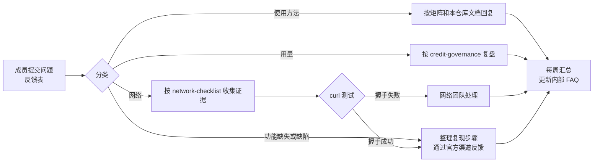

# 落地手册：启动日、workshop、试用期反馈与月度核对（FR-8）

> Prototype，不用于生产。议程是模板，不含任何客户信息；时长按团队情况调整。产品事实编号见 `docs/architecture.md`。

## 1. 启动日（Activation Day）议程模板

| 环节 | 内容 | 产出 |
|---|---|---|
| 准备（会前） | 管理员完成 profile 与订阅（`enterprise-admin.md`）；网络团队按 `network-checklist.md` 放行；确认 MCP 治理设置是否允许 Playwright MCP（F-36）；确认是否启用 Cloud Sessions（F-43） | 参会者可登录；网络检查通过 |
| 开场 | 试用目标、范围（仅非生产仓库）、反馈渠道 | 共识 |
| 安装与登录 | 安装 IDE/CLI，用组织登录方式登录（F-30、F-35） | 全员可用 |
| 基础操作 | 聊天、`#` 上下文引用（F-10）、文档附件（F-11）、Autopilot/Supervised（F-17） | 每人完成一个小改动 |
| 团队配置 | 讲解仓库 `.kiro/` 的 steering、hooks、MCP（`examples/`） | 团队配置入库 |
| Credit 说明 | 计量方式和降低消耗的做法（`credit-governance.md`） | 参会者知道如何查看用量 |
| 收尾 | 反馈方式与第一周的问题收集安排（第 3 节） | 反馈表链接 |

## 2. Workshop 模板（两期）

**第一期：本地会话的验证闭环**

1. 复制 `examples/` 到练习仓库根目录，按 `deployment-guide.md` 启动示例前端并运行浏览器测试。
2. 在 Kiro 中提出一个前端改动（例如新增一个状态筛选项），观察 steering 载入、Playwright MCP 调用、Stop hook 运行测试（`demo-script.md`）。
3. 故意引入一个控制台错误（`?simulate-error=1` 页面演示检测效果），讨论如何把检查写进 steering。

**第二期：长任务与云端会话**

1. 对照 `usage-modes.md` 讨论本地、云端会话、Crew 的选择。
2. （组织已启用 Cloud Sessions 时）从 IDE 的 Agent Focus 或 CLI `--cloud` 启动云端会话，关闭客户端后再从 Web 重新连接查看进度（F-13）。
3. 讨论网络访问档位和 secrets 的最小化（F-42）。

## 3. 试用期问题收集与回应流程



反馈表建议字段（不收集代码、不收集凭证）：

- 问题类别：长任务 / 交互效率 / 网络 / 用量 / 其他。
- 客户端与版本、登录方式、是否云端会话。
- 复现步骤与期望结果。
- 已尝试的处置（对应矩阵的哪一项）。

回应规则：

- 能用矩阵中的官方做法解决的，回复做法与官方链接。
- 官方当前不支持的，明确回复「当前不支持」，给出矩阵中的替代做法，并通过官方反馈渠道提交（GitHub kirodotdev/Kiro 的 Report a bug / Suggest an idea，或 CLI `/feedback`，F-38）。企业用户可同时联系 AWS Support。
- 只记录「已通过官方渠道反馈」和反馈链接；不在任何文档中承诺上线时间。

## 4. 月度核对付费与活跃用户

数据来源（都是管理员可下载的文件，F-34）：

1. Kiro 控制台 **Users & Groups → Subscriptions → Download CSV**（字段：User name、Subscription status、Kiro plan、Plan source、Activation date）。
2. S3 中当月的每日用户活动报告 CSV（按客户端类型分文件）。

运行离线核对脚本（不调用 AWS，只读本地文件）：

```bash
node tools/reconcile-subscriptions.mjs \
  --subscriptions subscriptions.csv \
  --activity reports/*.csv \
  --month 2026-01
# 用合成数据试运行：npm run reconcile:sample
```

输出分类与处理建议：

| 分类 | 含义 | 处理 |
|---|---|---|
| `active_with_usage` | 已订阅且当月有活动 | 无 |
| `active_no_usage` | 已订阅（计费）但当月无活动 | 与团队负责人确认是否需要保留；需要停用时按官方方式操作（F-32） |
| `pending` | 已订阅未激活；官方说明 Pending 不计费（F-32） | 提醒用户激活或取消 |
| `canceled_with_usage` | 已取消但当月有活动 | 月底生效的取消属正常（F-32） |
| `activity_without_subscription` | 活动报告中有、订阅导出中没有 | 检查关联键、是否在其他 profile、是否已删除用户（F-32、F-33） |

注意：订阅导出的列名拼写和关联键（默认用订阅导出的 `User name` 匹配活动报告的 `User_Email`）是假设，可用 `--sub-key`、`--sub-status`、`--act-key` 调整（Q-04）。需要图表或更完整的分析时，使用 `docs/prior-art.md` 中列出的 aws-samples 示例。
